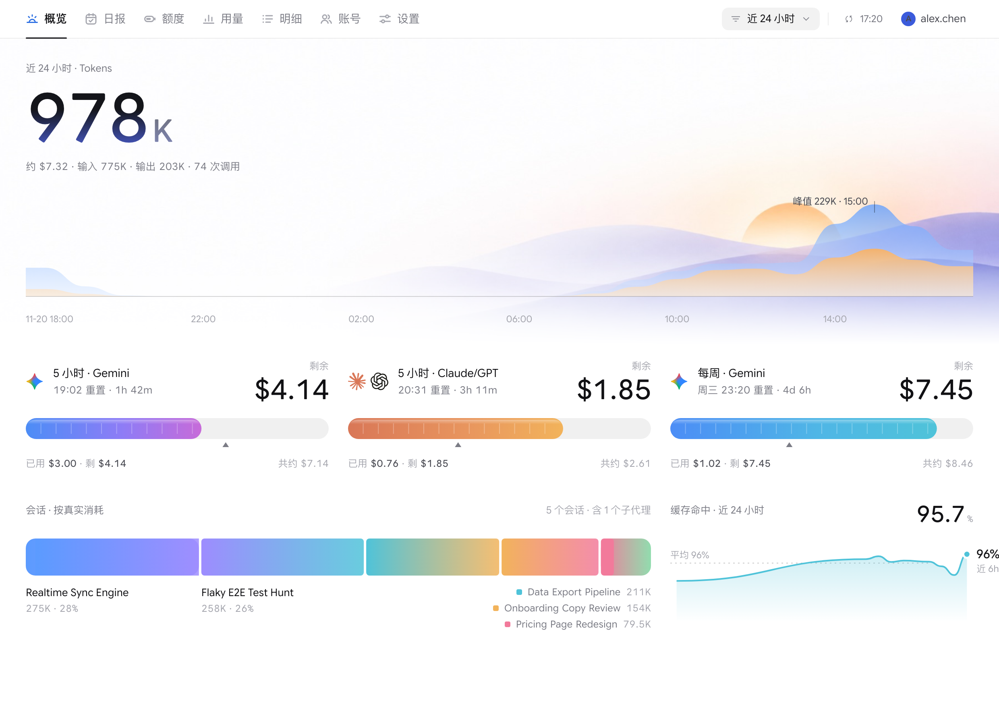
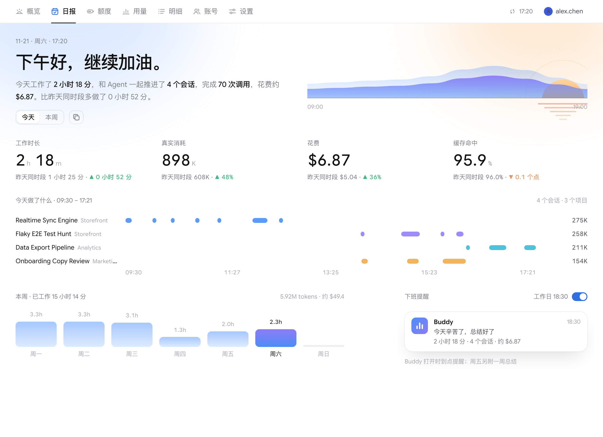
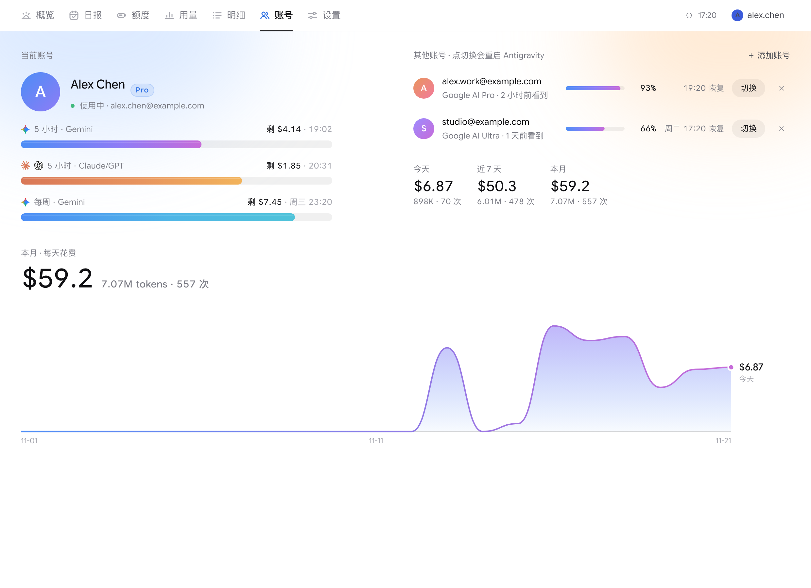
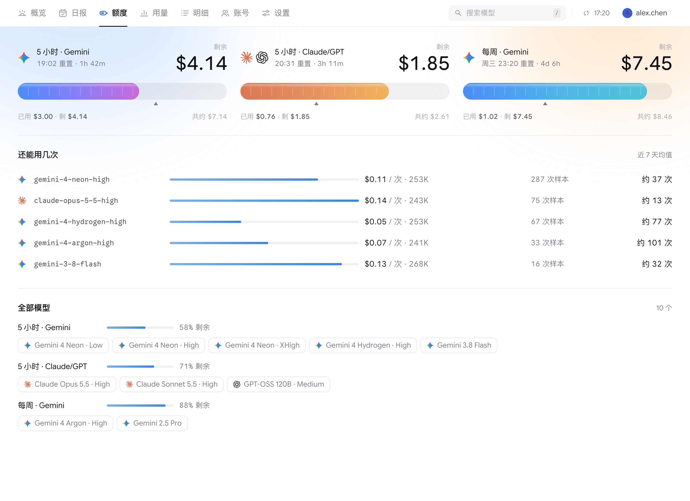
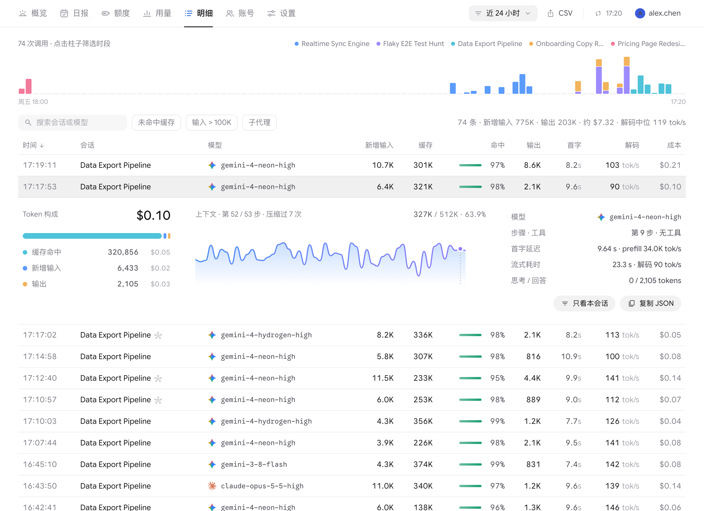

<div align="center">
  
  <h1>AntigravityBuddy</h1>
  <p>Antigravity 的额度、用量与多账号面板</p>
</div>



- **还剩多少**：每个额度池剩多少美元、几点恢复
- **花在哪**：按会话、按模型看 token 和成本
- **今天做了什么**：日报 / 周报，下班提醒
- **多账号**：一键切换 Google 账号

数据只在本机读取，不上传。

## 安装

把这段话发给 Antigravity、Claude Code 或 Codex，它会帮你装好：

```text
帮我安装 AntigravityBuddy：
1. 确认是 macOS，已装 Antigravity、python3 和 Node.js 18+（缺 Node 用 brew install node）
2. git clone https://github.com/lmk1010/AntigravityBuddy.git ~/AntigravityBuddy（已存在就 git pull）
3. cd ~/AntigravityBuddy && ./plugin/install.sh
4. 告诉我：在 Antigravity 左侧 Extensions 里点 Buddy 打开；没看到就 ⌘Q 重开
不要改动 Antigravity 本身的文件和我的登录信息。
```

或者自己装：

```sh
git clone https://github.com/lmk1010/AntigravityBuddy.git && cd AntigravityBuddy && ./plugin/install.sh
```

## 截图

| 日报 | 账号 |
| --- | --- |
|  |  |
| **额度** | **明细** |
|  |  |

<details>
<summary>更多</summary>

**多账号**：账号页点「添加账号」，Antigravity 重启到登录页，登录另一个账号即可。登录信息存在 macOS 钥匙串（`buddy-accounts`），之后一键切换。

**数据来源**：Antigravity 本地接口（额度、模型）和 `~/.gemini/antigravity/brain` 下的会话记录。成本按 API 公开价估算。

**开发**：`cd plugin && ./install.sh` 打包安装；`DEMO=1 node plugin/dist/sidecars/buddy_panel/dev.mjs` 用演示数据预览。

**更新 / 卸载**：`git pull && ./plugin/install.sh`；删除 `~/.gemini/config/plugins/buddy`。

</details>

## 许可证

[MIT](LICENSE)
