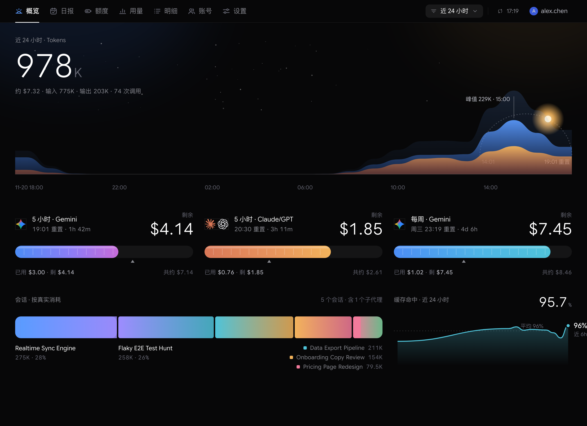
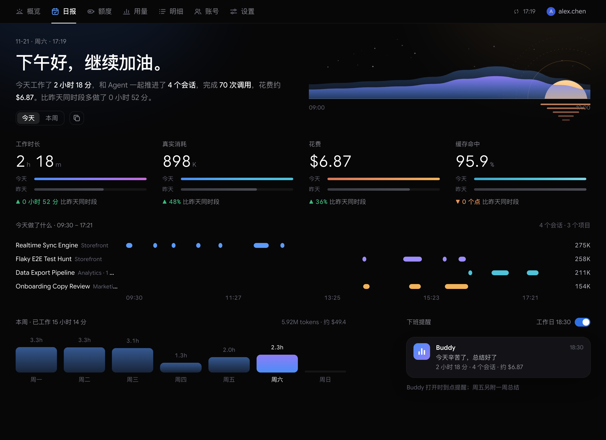
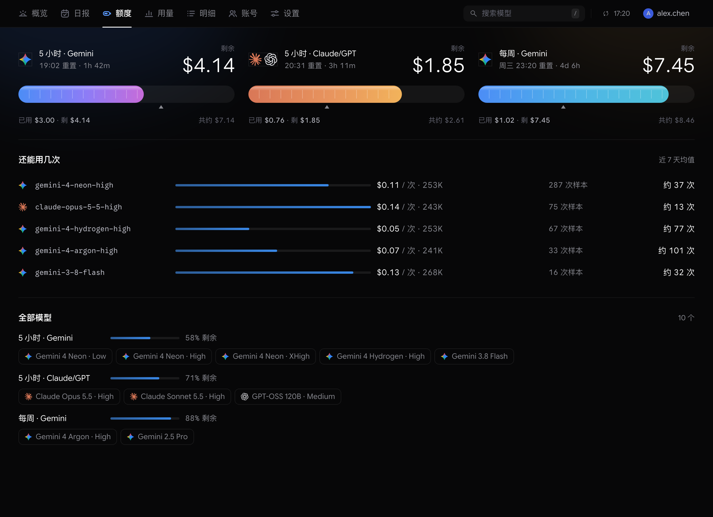
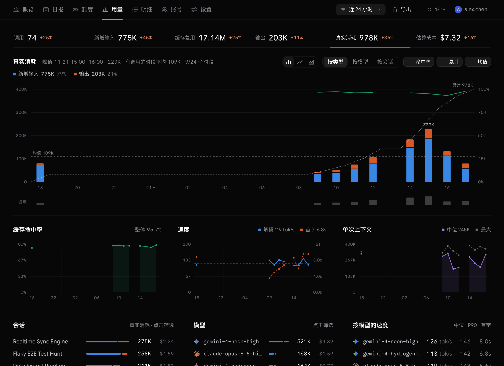
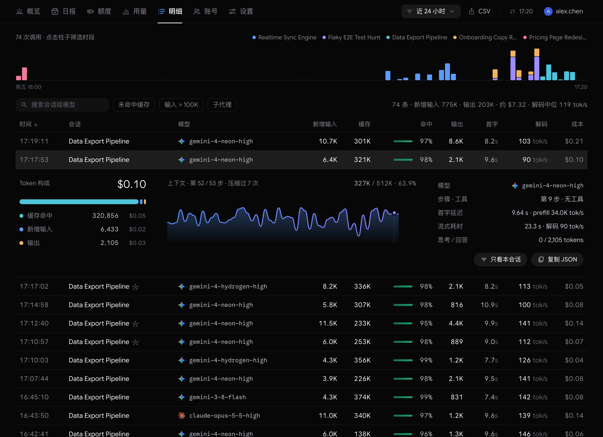
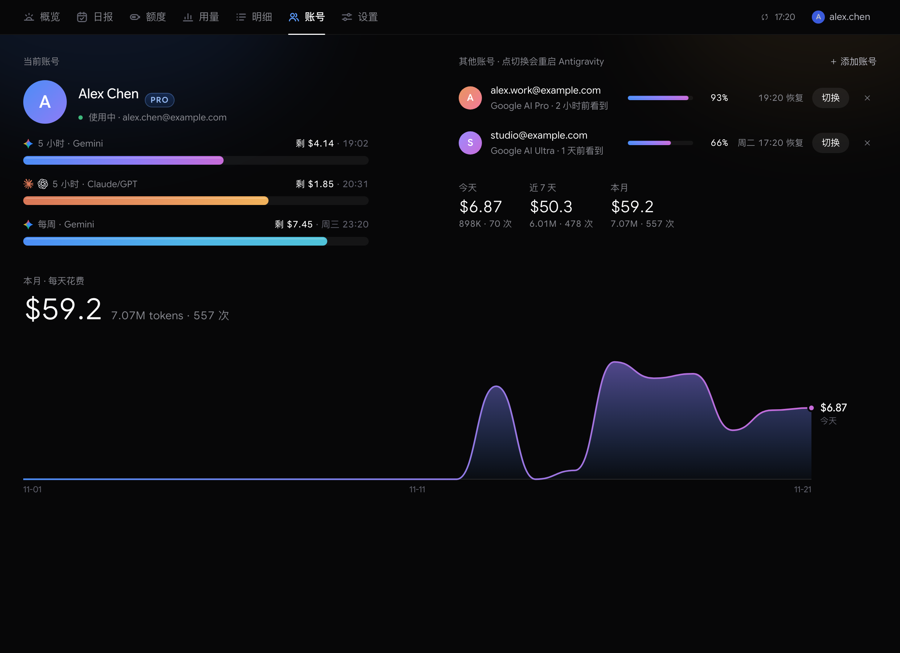
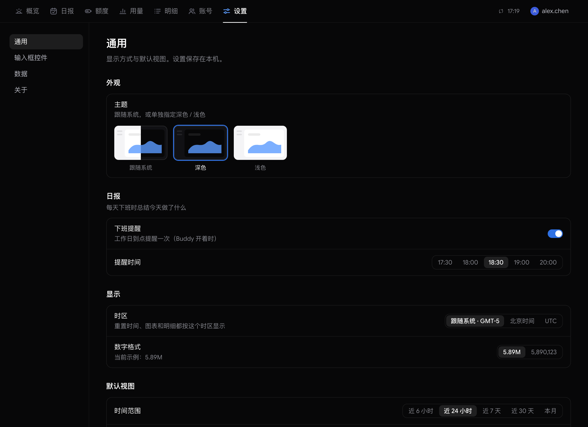

<div align="center">
  
  <h1>AntigravityBuddy</h1>
  <p><strong>Antigravity 的用量、额度与多账号面板</strong><br>还剩多少美元、什么时候恢复、花在了哪里，一眼看清。</p>

  <p>
    <a href="https://github.com/lmk1010/AntigravityBuddy/releases"></a>
    <a href="#安装"></a>
    <a href="#安装"></a>
    <a href="LICENSE"></a>
    <a href="https://github.com/lmk1010/AntigravityBuddy/stargazers"></a>
  </p>
</div>

<picture>
  <source media="(prefers-color-scheme: light)" srcset="assets/screenshots/overview-light.png">
  
</picture>

<sub>截图为演示数据，不含任何真实账号或会话。</sub>

Antigravity 不告诉你订阅还剩多少、什么时候恢复、这周烧在了哪里。Buddy 是一个 Antigravity 官方插件，读取本机的额度接口和会话记录，把这些摊在一屏里。所有数据只在本机读取，不发送到任何服务器。

## 用 AI 一键安装

把下面这段话原样发给 Antigravity、Claude Code、Codex 或任何能执行命令的 AI 助手，它会帮你装好：

```text
请帮我安装 AntigravityBuddy（Antigravity 的用量与额度插件），按以下步骤执行，每一步失败就停下来告诉我原因：

1. 确认环境：这是 macOS；`/Applications/Antigravity.app` 存在；`python3 --version` 和 `node --version`（需要 18 以上）都能运行。缺 Node 就用 `brew install node` 安装。
2. 下载：`git clone https://github.com/lmk1010/AntigravityBuddy.git ~/AntigravityBuddy`（目录已存在就进去执行 `git pull`）。
3. 安装：`cd ~/AntigravityBuddy && ./plugin/install.sh`。成功时会输出 `installed to ~/.gemini/config/plugins/buddy/...`。
4. 验证：`ls ~/.gemini/config/plugins/buddy/sidecars/buddy_panel/` 里应有 `main.mjs`、`app.js`、`index.html`、`styles.css` 和 `lib/` 目录。
5. 告诉我：在 Antigravity 左侧栏 Extensions 里点 **Buddy** 打开面板；如果没看到，完全退出 Antigravity（⌘Q）再打开。

不要修改 Antigravity 本身的任何文件，也不要改动我的登录信息。
```

## 功能

| 页面 | 内容 |
| --- | --- |
| **概览** | 一段时间的 token 走势，最紧张的 5 小时窗口画成太阳弧；每个额度池剩多少美元、共约多少、几点恢复；会话占比；缓存命中率 |
| **日报** | 今天 / 本周工作了多久、推进了哪些会话、花了多少，与昨天 / 上周同期对比；工作日下班时提醒，一键复制成 Markdown |
| **额度** | 每个额度池的剩余美元与恢复时间；每个模型平均一次多少钱、按剩余额度还能调用几次；全部模型清单 |
| **用量** | 调用、输入、缓存、输出、真实消耗、成本六项指标（带环比）；主图可切柱状 / 折线 / 面积，可按类型 / 模型 / 会话拆分；缓存命中、解码速度、上下文走势 |
| **明细** | 每次调用一行：模型、首字延迟、解码速度、缓存命中、成本；时间带按会话着色，点击筛选时段；可导出 CSV |
| **账号** | 多个 Google 账号一键切换；每个账号最近一次的额度和恢复时间，哪个号还有余量一眼看出 |
| **设置** | 深色 / 浅色 / 跟随系统；日报提醒时间；时区、数字格式；输入框控件 |

另有可选的**输入框控件**（设置 → 输入框控件）：在 Antigravity 输入框右侧显示上下文占用、解码速度和当前模型额度，点开上下文圆环可以看到系统提示、工具、对话、子代理各占多少。它需要以调试模式启动 Antigravity，默认关闭。

## 截图

<sub>全部为演示数据。深色 / 浅色随 GitHub 主题切换。</sub>

**日报**

<picture>
  <source media="(prefers-color-scheme: light)" srcset="assets/screenshots/report-light.png">
  
</picture>

**额度**

<picture>
  <source media="(prefers-color-scheme: light)" srcset="assets/screenshots/quota-light.png">
  
</picture>

**用量**

<picture>
  <source media="(prefers-color-scheme: light)" srcset="assets/screenshots/tokens-light.png">
  
</picture>

**明细**

<picture>
  <source media="(prefers-color-scheme: light)" srcset="assets/screenshots/ledger-light.png">
  
</picture>

**账号**

<picture>
  <source media="(prefers-color-scheme: light)" srcset="assets/screenshots/accounts-light.png">
  
</picture>

**设置**

<picture>
  <source media="(prefers-color-scheme: light)" srcset="assets/screenshots/settings-light.png">
  
</picture>

## 安装

需要 macOS、Antigravity 桌面版、Python 3 和 Node.js 18 以上。

```sh
git clone https://github.com/lmk1010/AntigravityBuddy.git
cd AntigravityBuddy
./plugin/install.sh
```

脚本把 `plugin/src` 打包，安装到 `~/.gemini/config/plugins/buddy`，并刷新已经打开的面板。之后在 Antigravity 左侧栏 Extensions 里打开 **Buddy**。

更新：`git pull && ./plugin/install.sh`。卸载：删除 `~/.gemini/config/plugins/buddy`。

## 多账号怎么用

1. 打开 **账号** 页，点 **添加账号**。Antigravity 会重启到登录页，用另一个 Google 账号登录。
2. Buddy 会自动记下每个登录过的账号。之后在账号页点 **切换**，Antigravity 自动重启并换到那个账号，不需要重新输入密码。
3. 不在用的账号会显示最近一次看到的额度和恢复时间，方便挑一个有余量的号。

登录信息保存在 macOS 钥匙串（服务名 `buddy-accounts`），不会写进任何文件；`~/.gemini/antigravity/plugin_data/buddy/accounts.json` 只记邮箱、时间和额度读数。切换时正在生成的回复会中断。

## 工作原理

Buddy 是 Antigravity 的官方 sidecar 插件，跑在宿主进程里，本地接口地址和令牌由宿主注入，无需配置。

| 数据 | 来源 |
| --- | --- |
| 账号、各模型剩余比例与恢复时间 | 本地 RPC：`GetUserStatus`、`GetAvailableModels` |
| 逐次调用的 token | `~/.gemini/antigravity/brain/<会话>/.system_generated/logs/transcript.jsonl` |
| 首字延迟、流式耗时、确切模型、上下文构成 | 本地 RPC：`GetCascadeTrajectoryGeneratorMetadata` |
| 会话标题、父子关系 | `~/.gemini/antigravity/conversation_summaries.db`（只读） |
| 账号登录（切换用） | macOS 钥匙串：Antigravity 的 `gemini` 项，Buddy 另存到 `buddy-accounts` |

解析结果缓存在 `~/.gemini/antigravity/plugin_data/buddy/`，Antigravity 清掉旧会话后统计仍在。

## 开发

```sh
cd plugin && python3 build.py          # 打包 src 到 dist
./install.sh                           # 打包并安装
```

本地调试（Antigravity 需在运行）：

```sh
./tools/probe.sh                       # 找到本地接口端口与令牌
cd plugin/dist/sidecars/buddy_panel
ANTIGRAVITY_LS_ADDRESS=127.0.0.1:<port> ANTIGRAVITY_CSRF_TOKEN=<token> node dev.mjs
# 打开 http://localhost:4599/?tab=overview&theme=1

DEMO=1 DEMO_AT=17:20 PORT=4600 node dev.mjs   # 演示数据，截图用；页面加 &at=17:20
```

| 路径 | 内容 |
| --- | --- |
| `plugin/src` | 前端，无框架，按页面拆分 |
| `plugin/dist/sidecars/buddy_panel` | 服务端：`main.mjs`；`lib/data.mjs` 数据、`lib/accounts.mjs` 多账号、`lib/native.mjs` + `lib/inject.js` 输入框控件、`lib/demo.mjs` 演示数据 |
| `design` | 设计稿与截图 |
| `docs` | Antigravity 本地接口与数据格式笔记 |
| `tools` | 探测、重载、调试脚本 |

## 已知限制

- 成本按 API 公开价换算，订阅本身不按此计费，用于横向比较。
- 额度对应的美元数由「本窗口已花 ÷ 已用比例」推算，用得太少时不估。
- 多账号切换只支持 macOS；按账号固定出口 IP 尚未实现。
- 只统计本机会话；依赖 Antigravity 的本地接口，宿主大版本更新后可能需要适配。

## 许可证

[MIT](LICENSE)
