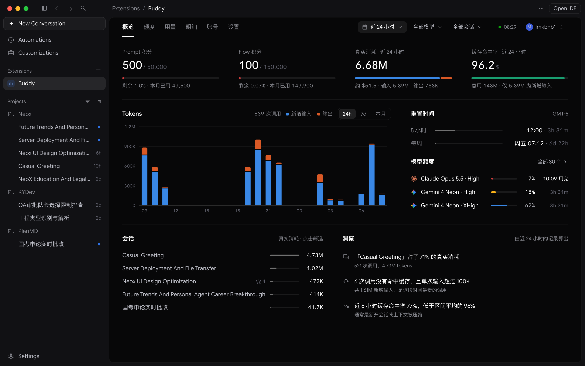
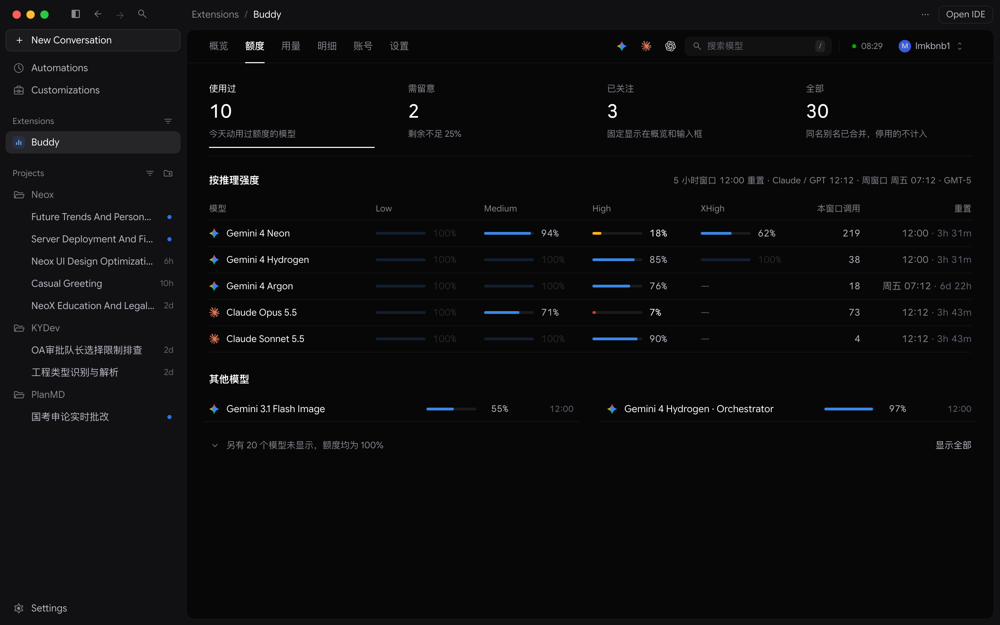
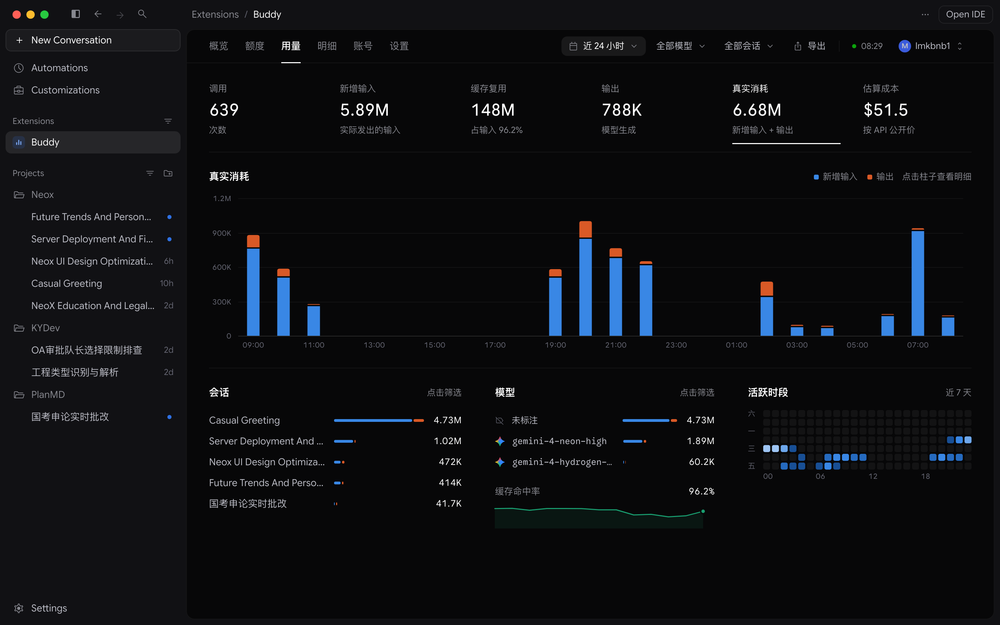
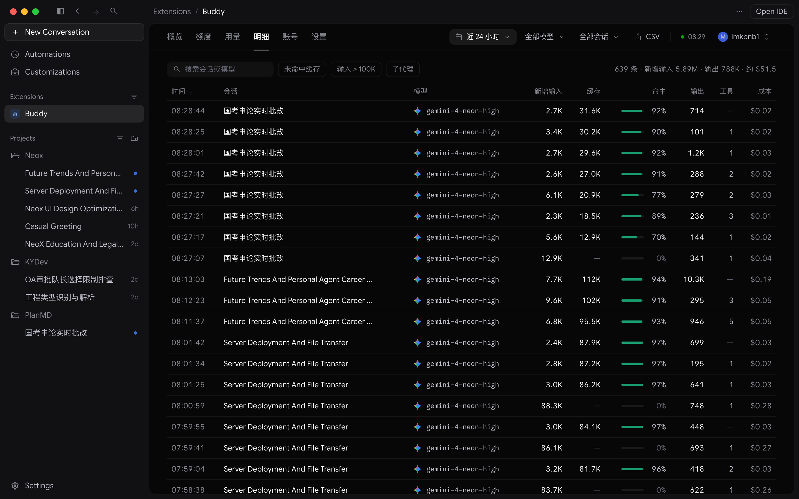
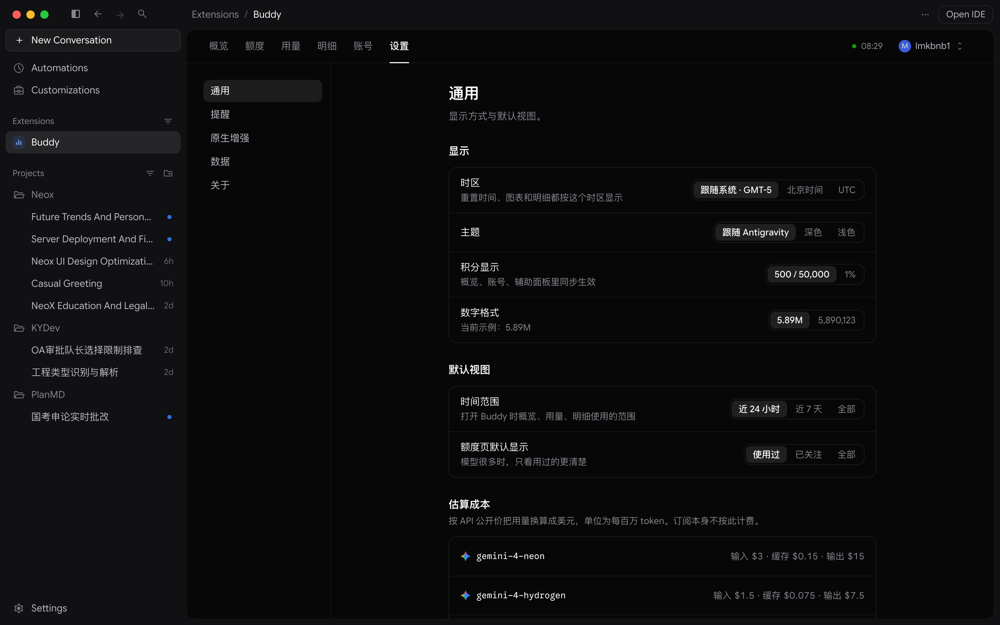

<div align="center">
  
  <h1>AntigravityBuddy</h1>
  <p><strong>Antigravity 的用量、额度与成本面板</strong><br>还剩多少，花在哪，有什么值得注意。</p>

  <p>
    <a href="https://github.com/lmk1010/AntigravityBuddy/releases"></a>
    <a href="#安装"></a>
    <a href="#安装"></a>
    <a href="LICENSE"></a>
    <a href="https://github.com/lmk1010/AntigravityBuddy/stargazers"></a>
  </p>
</div>



Antigravity 不告诉你订阅还剩多少、这个月烧在了哪里。Buddy 补上这部分：它读取 Antigravity 的本地接口和会话账本，把额度、真实 token 消耗、估算成本和缓存命中率摊在一屏里。

所有数据只在本机读取，不发送到任何服务器。

## 功能

| 页面 | 内容 |
| --- | --- |
| **概览** | 最紧张的两个额度池及重置倒计时；真实消耗、估算成本、缓存命中率；token 走势；模型剩余额度；会话排行与自动洞察 |
| **额度** | 按 5 小时 / 每周窗口归组的全部模型额度，燃尽图与耗尽预测 |
| **用量** | 调用次数、新增输入、缓存复用、输出、真实消耗、估算成本六项指标（带环比）；主图可按类型 / 模型 / 会话堆叠；缓存命中率、解码速度、首字延迟、单次上下文四条走势 |
| **明细** | 逐次调用记录，可排序、搜索、展开单步详情、导出 CSV |
| **账户** | 已登录账号及其额度对应关系，支持切换 |
| **设置** | 告警阈值、输入框控件、数据来源与导出 |

筛选器对概览、用量、明细通用：13 种时间预设或自定义区间，粒度（自动 / 15 分钟 / 小时 / 天），以及厂商、额度池、主会话 / 子代理、未命中缓存、大输入、模型、会话。

<details>
<summary>更多截图</summary>

| 额度 | 用量 |
| --- | --- |
|  |  |
| **明细** | **设置** |
|  |  |

</details>

## 安装

需要 Antigravity 桌面版、Python 3 和 Node.js 18 以上。

```sh
git clone https://github.com/lmk1010/AntigravityBuddy.git
cd AntigravityBuddy
./plugin/install.sh
```

脚本把 `plugin/src` 打包成插件文件，安装到 `~/.gemini/config/plugins/buddy`，然后尝试刷新已经打开的面板。完成后在 Antigravity 的 Extensions 里打开 **Buddy**。

界面文件（`app.js`、`styles.css`、`index.html`）改动即时生效，刷新面板即可；改动了 `main.mjs` 或 `lib/` 需要在 Antigravity 里关掉再打开 Buddy。

## 使用

- 顶部的筛选器作用于概览、用量、明细三个页面，切换页面时保留。
- 点击任意柱子可以下钻到单次调用；点击会话名可以按该会话过滤。
- 「真实消耗」只计新增输入与输出，缓存复用的部分单独列出，不重复计入成本。
- 输入框控件在设置里开启：在 Antigravity 输入框右侧显示上下文占用、解码速度和当前模型额度。

## 工作原理

Buddy 是 Antigravity 的官方插件，跑在宿主进程内，`ANTIGRAVITY_LS_ADDRESS` 和 `ANTIGRAVITY_CSRF_TOKEN` 由宿主注入，无需手工配置。

| 数据 | 来源 | 用途 |
| --- | --- | --- |
| 账号、额度、模型可用性 | 本地 Connect RPC：`GetUserStatus`、`GetAvailableModels` | 剩余积分、各模型剩余比例与重置时间 |
| 逐次调用的 token | `~/.gemini/antigravity/brain/<会话>/.system_generated/logs/transcript.jsonl` | 用量、走势、会话排行 |
| 首字延迟、流式耗时、上下文上限 | RPC：`GetCascadeTrajectoryGeneratorMetadata` | 性能指标与上下文分析 |
| 会话标题、父子关系 | `~/.gemini/antigravity/conversation_summaries.db`（只读） | 会话归类、子代理识别 |

数据缓存写入 `~/.gemini/antigravity/plugin_data/buddy/`。除此之外不发起任何网络请求。

## 开发

```sh
cd plugin && python3 build.py          # 打包 src 到 dist
./install.sh                           # 打包并安装
```

独立调试需要 Antigravity 正在运行：

```sh
./tools/probe.sh                       # 自动发现端口与 CSRF token
cd plugin/dist/sidecars/buddy_panel
ANTIGRAVITY_LS_ADDRESS=127.0.0.1:<port> ANTIGRAVITY_CSRF_TOKEN=<token> node dev.mjs
# http://localhost:4599
```

| 路径 | 内容 |
| --- | --- |
| `plugin/src` | 前端源码，无框架，按页面拆分；`build.py` 负责打包 |
| `plugin/dist/sidecars/buddy_panel` | sidecar 服务端：`main.mjs`、`lib/data.mjs`（数据）、`lib/native.mjs` + `lib/inject.js`（输入框控件） |
| `design` | 可交互原型与渲染出的界面截图 |
| `docs` | Antigravity 本地接口与数据格式的分析笔记 |
| `tools` | 探测、重载、CDP 调试脚本 |

## 已知限制

- 成本按 API 公开价换算，订阅本身不按此计费，数字只用于横向比较。
- 额度对应的美元数由「已用比例 + 已花费」反推，是估算值。
- 只统计本机会话。换机器或清空 `brain` 目录后，历史无法恢复。
- 依赖 Antigravity 的本地接口。宿主版本更新导致接口变化时，需要跟进适配。

## 许可证

[MIT](LICENSE)
