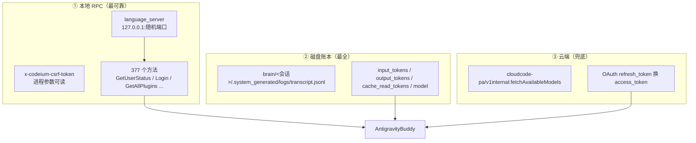
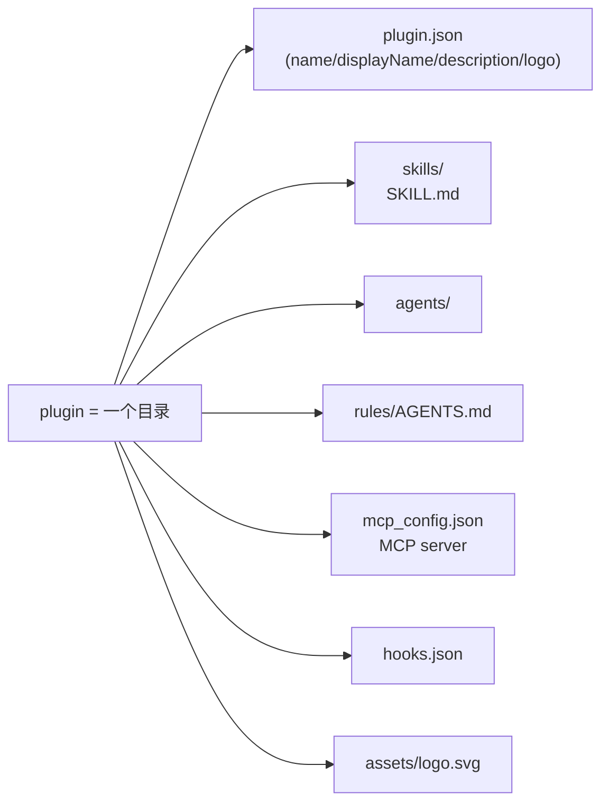
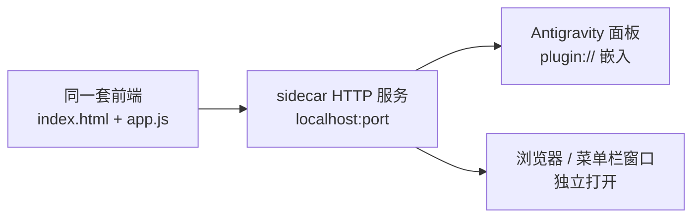
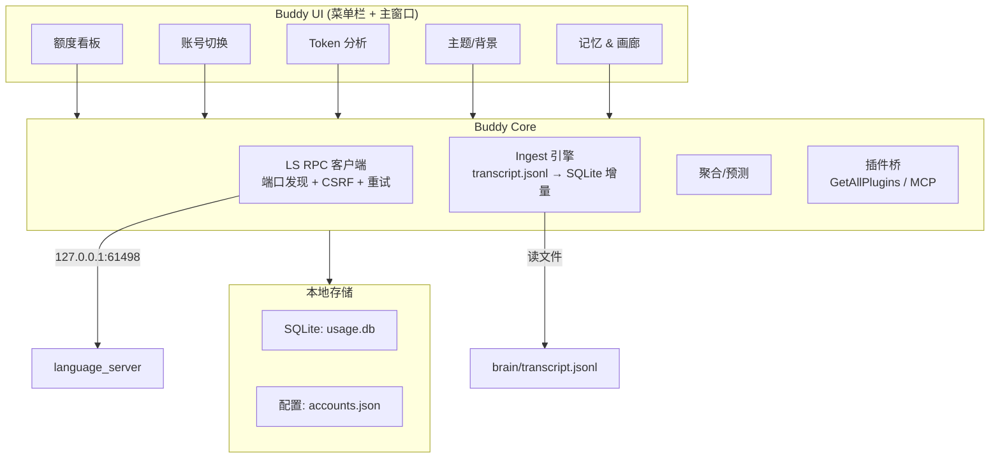

# AntigravityBuddy 可行性分析

> 分析对象：`~/Downloads/Antigravity.dmg`（Hub 2.32.2）与 `~/Downloads/Antigravity IDE.dmg`（IDE 2.7.0），
> 结合已安装的 Hub 2.33.0 / IDE 2.7.0、`AI/Project/text/antigravity-rea` 既有逆向成果，以及本机真实运行态实测。
> 分析方式：DMG 只读挂载 + asar 解析 + Go 二进制字符串/符号取证 + **本地 RPC 实调**。

---

## 0. 一页结论

**能做，而且比你现在的 `Antigravity Tools.app` 好一大截。** 关键原因只有一个：

> Antigravity 自己就带一个 **377 个方法的本地 HTTP API**（Language Server，`127.0.0.1` + CSRF token）。
> 额度、账号、插件、记忆、媒体产物全在里面。旧工具绕了 proxy 去"猜"流量，属于走远路。

| 你要的功能 | 可行性 | 能做到什么程度 |
|---|---|---|
| 额度统计 | **100%** | 绝对数（不是百分比）+ 39 个模型各自剩余 + 重置时间，实测通 |
| Token 统计（补全旧的缺口） | **100%** | 读 Antigravity 自己的账本，覆盖全部会话，无需代理 |
| 多账号切换 | **90%** | 官方 RPC 就有登录/切号，旧工具是绕路实现 |
| 插件支持 | **100%** | 官方插件体系 + 96 个市场插件，Buddy 可打包成插件 |
| 换主题 / 换背景 | **40%** | 只能改背景色/透明/应用图标，不能任意换肤 |
| 记忆 | **95%** | 官方记忆 RPC + 全量会话可检索 |
| 绘画 / 图片导入 | **90%** | 官方媒体产物 RPC + 独立图片模型配额 |

---

## 1. 技术底座：三个数据面



### 1.1 本地 RPC 是怎么找到的

`language_server` 启动参数里带齐了全部接入信息（实测取自进程命令行）：

```
language_server --standalone --subclient_type hub
  --csrf_token 8c766625-9848-481f-b662-9e13bc9b3007
  --cloud_code_endpoint https://daily-cloudcode-pa.googleapis.com
  --enable_sidecars --host_bridge_url=http://127.0.0.1:61494
```

监听端口从 `lsof` 拿（本次为 `61498`，每次启动会变），`GET /healthz` 探活，之后所有调用：

```bash
curl -X POST "http://127.0.0.1:61498/exa.language_server_pb.LanguageServerService/GetUserStatus" \
  -H "Content-Type: application/json" \
  -H "x-codeium-csrf-token: $CSRF" -d '{}'
```

> 这是 Antigravity 官方自己给 agent 用的通道 —— `builtin/skills/plugin/SKILL.md` 里就教 agent 这么调。

---

## 2. 额度统计：能做，而且比旧工具准

### 实测返回（本机真实数据）

```json
{
  "userStatus": {
    "name": "Ming Mike",
    "email": "lmkbnb1@gmail.com",
    "planStatus": {
      "planInfo": {
        "teamsTier": "TEAMS_TIER_PRO", "planName": "Pro",
        "monthlyPromptCredits": 50000,
        "monthlyFlowCredits": 150000,
        "canBuyMoreCredits": true,
        "canCustomizeAppIcon": true
      },
      "availablePromptCredits": 500,
      "availableFlowCredits": 100
    }
  }
}
```

配合 `GetAvailableModels`，拿到 **39 个模型**各自的 `quotaInfo.remainingFraction` 和 `resetTime`：

| 模型 | 剩余比例 | 重置时间 |
|---|---|---|
| gemini-4-neon-high | 1.0 | 2026-11-20T17:00:37Z |
| gemini-4-argon-high | 1.0 | 2026-11-27T12:12:55Z |
| claude-opus-5-5-high | 1.0 | 2026-11-20T17:12:55Z |
| gemini-4-carbon-disabled | — | 已停用 |
| …（共 39 个） | | |

### 比旧工具强在哪

| 维度 | 旧工具（Antigravity Tools） | Buddy 方案 |
|---|---|---|
| 获取方式 | 自建 OAuth + 手动刷新 token | 本地 RPC，**不碰凭据** |
| 额度粒度 | `percentage` 百分比 | **绝对数** `availablePromptCredits` + 百分比 |
| 覆盖范围 | 每账号单次快照 | 可记录时间序列 → 绘制消耗曲线、预测耗尽时刻 |
| 稳定性 | 依赖 OAuth 与设备指纹绕过 | 依赖本机 loopback，无风控 |
| 失效风险 | Google 改接口 / 改客户端 → 失效 | Antigravity 改 RPC 名才失效 |

### 待运行时确认的一点

`availablePromptCredits: 500` 与 `monthlyPromptCredits: 50000` 是两个层级。500 更像"当前窗口剩余"，50000 是月度总额。
**500 是不是"只剩 1%"，需要连续采样几个窗口才能定论**，第一版不对此下结论，只如实展示两个数字 + 重置时间。

---

## 3. Token 统计：找到"不全"的根因了

### 根因

旧工具走 **本地 proxy 拦截请求**，只有流量经过它的 proxy 才记账。所以：

- 不走 proxy 的调用 → 全部丢失
- 换账号、直连、HTTP/2 复用 → 丢失
- 结果：`token_stats.db` 里只有 **14 行**记录

### 正解：读 Antigravity 自己的账本

路径：`~/.gemini/antigravity/brain/<会话ID>/.system_generated/logs/transcript.jsonl`

每个模型步骤一条 JSON，字段实测：

```json
{
  "step_index": 1, "source": "MODEL", "type": "PLANNER_RESPONSE", "status": "DONE",
  "created_at": "2026-11-18T03:55:44Z",
  "input_tokens": 13541, "cache_read_tokens": 0, "output_tokens": 1413,
  "thinking": "...", "tool_calls": [...], "model": "gemini-4-neon-high"
}
```

### 全量实测结果

| 指标 | 数值 |
|---|---|
| 会话数 | 18 |
| Token 记录数 | 1,218 |
| 累计 input | 20,291,829 |
| 累计 output | 1,810,142 |
| 累计 cache_read | 267,217,509 |
| 时间跨度 | 2026-11-18 → 2026-11-20 |
| 按模型 | `gemini-4-hydrogen-tiered-high` 19 次 / `gemini-4-neon-high` 47 次 |

> **这是 100% 覆盖 —— 因为这就是 Antigravity 自己记账的地方，不是旁路采样。**

### 能做的分析

- 按 会话 / 模型 / 小时 / 天 聚合
- cache 命中率（`cache_read_tokens / input_tokens`，实测 93%，这是省钱的大头）
- thinking token 与输出质量的关系
- 与额度剩余量对照 → **"这个模型还能聊几轮"**

### 局限（如实说明）

1. `brain/` 只保留近期会话，不等于永久历史 → 需要 Buddy 定期 ingest 到自己的库，**从今天起不再丢**。
2. 粒度是"每步一条"，不是每次 HTTP 请求；缓存命中的细微差异看不出来。
3. 部分老会话无 `transcript.jsonl`（19 个会话目录 / 18 个 transcript）。

---

## 4. 多账号切换：官方就有接口

`GetUserStatus` 已经返回当前账号邮箱。更重要的是 RPC 列表里有：

| RPC | 用途 |
|---|---|
| `Login` / `LoginWithBrowser` | 发起登录 |
| `GetLoginSession` | 查询登录会话 |
| `SwitchLoginToAuthCode` / `SubmitLoginAuthCode` | 切换为授权码模式（自动化友好） |
| `AuthLogout` | 登出 |
| `GetAuthStatus` / `HasAuthToken` | 登录态检测 |
| `SetDefaultPluginAuthAccount` / `SignInPluginAuthProvider` | 插件级账号绑定 |

**这意味着：不需要像旧工具那样造 proxy + 伪造设备指纹。** 走官方登录流程即可。

### 三种实现路线与推荐

| 路线 | 做法 | 优点 | 缺点 | 建议 |
|---|---|---|---|---|
| A. 官方 RPC 切号 | `AuthLogout` → `LoginWithBrowser` → 写回 cookie | 合规、稳 | 每次要过一次浏览器授权 | **主路线** |
| B. 凭据池 | 保存多份 refresh_token，切时替换 | 快、无需浏览器 | 依赖 Keychain `Antigravity Safe Storage` 解密，升级易失效 | 备选/加速 |
| C. proxy 劫持 | 复刻旧工具 | 无需改 Antigravity | 正是"不全"的来源 | **不采用** |

### 现实限制

- Google 账号登录有风控，**无法做到"毫秒级无感切换"**，合理目标是"点一下，10 秒内切完"。
- 同一时间 Antigravity 只认一个账号；多账号并行需要多开（不同 `--app_data_dir`），这属于 P2。

---

## 5. 插件：官方体系，Buddy 可以长在里面

### 体系结构（实测）



安装位置：`~/.gemini/config/plugins/<name>/`；内置在 `~/.gemini/antigravity/builtin/plugins/`。
管理 RPC：`GetAllPlugins`（含 skills/agents/rules/mcp/hooks 全清单）、`InstallCascadePlugin`、`DeletePlugin`、`GetMarketplaceBundles`、`SearchMarketplace`、`SubscribeToPlugins`。

### 市场现状（实测缓存）

| 市场 | 数量 | 代表 |
|---|---|---|
| 官方 `antigravity-plugins-official` | 28 | gmail / gdocs / gsheets / chrome-devtools / firebase / flutter |
| 伙伴 `antigravity-plugins-partners` | 68 | notion / figma / stripe / supabase / linear / datadog / postman |

安装包形态：`{type:"archive", url, sha256}` 的 zip。

### 对 Buddy 的意义

**Buddy 可以做成两层，互相增强：**

1. **独立 App**（看板/切号/主题）—— 数据量大、要常驻菜单栏
2. **Antigravity 插件**（`~/.gemini/config/plugins/antigravity-buddy/`）
   - `skills/quota-report/SKILL.md` → 让 agent 自己会查额度
   - `skills/account-switch/SKILL.md` → agent 内切号
   - `mcp_config.json` → 把 Buddy 的统计库暴露成 MCP 工具，agent 能直接问"我今天用了多少 token"

这条路径**完全在官方框架内**，不是 hack。

### 5.1 插件可以带自己的界面，并嵌进 Antigravity

**这不是推测 —— 本机的 Swarm 插件就是活例子。** `GetSidecars` 实测返回：

```json
{
  "sidecarId": "swarm/swarm_board",
  "config": {
    "command": "node", "args": ["main.mjs"],
    "hasWebUi": true,
    "uiConfig": {
      "displayName": "Swarm",
      "views": [{ "entrypoint": "SIDECAR_UI_ENTRYPOINT_AUX_PANE",
                  "path": "/", "title": "Swarm" }]
    }
  },
  "status": "SIDECAR_STATUS_RUNNING",
  "webPort": 61548,
  "baseUrl": "http://localhost:61550?token=..."
}
```

它的实现就是普通网页：`index.html` + `app.js` + `styles.css` + `main.mjs`（Node 起 HTTP 服务，读本地文件）。

**可用的嵌入位置（二进制枚举实测）**：

| 枚举值 | 位置 | 效果 |
|---|---|---|
| `SIDECAR_UI_ENTRYPOINT_SIDEBAR` | 侧边栏 | 左侧常驻窄栏 |
| `SIDECAR_UI_ENTRYPOINT_AUX_PANE` | 辅助面板 | 与对话并排（Swarm 用的） |
| `SIDECAR_UI_ENTRYPOINT_FULL_PANE` | 整块面板 | 占据主区域 |

另有 `SIDECAR_UI_TITLE_BAR_STYLE_HIDDEN` 可隐藏标题栏，让面板看起来像原生界面。

**对架构的含义 —— 一套前端，两个入口：**



所以"新做界面"和"融入 Antigravity"**不是二选一**，而是同一个页面同时挂在两边。

**边界（必须说清）**：

| 能做 | 不能做 |
|---|---|
| 新增侧边栏 / 辅助面板 / 整块面板 | 改动 Antigravity 已有的额度条、设置页、主对话区布局 |
| 面板内任意自绘 UI（图表、列表、按钮） | 替换 Antigravity 的代码高亮主题 / 全局皮肤 |
| 通过 RPC 读写额度、账号、插件状态 | 覆盖或隐藏它的原生控件 |

**待验证**：`sidecar_sdk` 是运行时注入的模块（不在 `node_modules`，也不在 app 包内），需实测能否 `import`。若不可用，退化为纯 Node HTTP 服务（只需监听 `webPort`），不影响可行性。

---

## 6. 个性化：主题、记忆、绘画

### 6.1 主题 / 背景 —— 能做到 40%

| 能力 | 证据 | 可行性 |
|---|---|---|
| 改面板背景色 | `hubSurfaceBackgroundColor`（当前 `#070708`） | ✅ 直接改 |
| 窗口透明/毛玻璃 | `setHubSurfaceTransparent(...)` | ✅ 有实现 |
| 自定义应用图标 | `canCustomizeAppIcon: true`（你的 Pro 计划已开启） | ✅ |
| 任意换肤 / 换壁纸 / 改代码高亮主题 | 无公开 API，`product_skin` 是枚举 | ❌ |

**结论：Antigravity 本体只能调背景色和图标。真正的主题系统要做在 Buddy 自己的界面里** —— 这反而是优势，Buddy 可以做深色/浅色/自定义配色/背景图，比 Antigravity 自己好看。

### 6.2 记忆 —— 能做到 95%

官方 RPC 齐全：

| RPC | 用途 |
|---|---|
| `GetCascadeMemories` / `UpdateCascadeMemory` / `DeleteCascadeMemory` | 会话级记忆 |
| `GetUserMemories` | 用户级长期记忆 |
| `GetKnowledgeItems` | 知识条目 |
| `SearchConversations` | 跨会话检索 |
| `ForkConversation` | 从某点分叉 |
| `GetCascadeTrajectory` / `ConvertTrajectoryToMarkdown` | 轨迹导出 |

加上 `conversation_summaries.db` + `annotations/` + `brain/*/transcript.jsonl`，Buddy 可以做：

- **跨会话长期记忆**：把重要决策/偏好抽成条目，注入 `rules/AGENTS.md` 或记忆 RPC
- **归档检索**：全量会话全文索引，"上个月那个方案怎么定的"
- **记忆去重/冲突检测**：同一件事被记了两个版本时提示

### 6.3 绘画 / 图片导入 —— 能做到 90%

| 证据 | 说明 |
|---|---|
| `gemini-3.1-flash-image`、`gemini-3-pro-image` 独立配额 | 图片模型单列额度 |
| `SaveMediaAsArtifact` / `DeleteMediaArtifact` / `GetArtifactSnapshots` | 官方产物管理 |
| transcript 的 `media` 字段（全量 151 处） | 每次产图都有记录 |
| `supportsImages: true` + 一长串 `supportedMimeTypes` | 图片/音频/视频/PDF 全支持 |

Buddy 可以做：生成历史画廊、按会话归档、批量导出、把本地图片直接投喂到指定会话。

---

## 7. 明确做不到 / 不建议做

| 项 | 原因 |
|---|---|
| 任意换肤、替换 Antigravity 代码高亮主题 | 无公开 API，`product_skin` 是服务端枚举 |
| 无感毫秒级切号 | Google 登录风控，只能做到"点一下 10 秒" |
| 多账号真并行（同一进程） | Antigravity 单实例单账号；需多开不同 `--app_data_dir`（P2，资源翻倍） |
| 绕过额度限制 | 不做，也不该做 |
| 依赖 proxy 劫持做统计 | 已被证明是"不全"的根因，弃用 |

---

## 8. 架构建议



### 技术栈建议

| 层 | 选择 | 理由 |
|---|---|---|
| 外壳 | **Tauri 2**（Rust） | 体积 ~10MB，常驻菜单栏，读写本地文件无需额外权限；与旧工具的 Rust 后端思路一致但更轻 |
| 前端 | React + TypeScript | 与现有习惯一致，主题系统好做 |
| 存储 | SQLite（rusqlite） | 增量 ingest、按时间聚合快 |
| RPC | `reqwest` + 自实现 Connect 调用 | 只需要 POST JSON，无需生成 proto |
| 图表 | 前端直接用（ECharts / Recharts） | 消耗曲线、模型分布 |

> 备选：如果想更快出第一版，可以先用 **单文件 HTML + 一个本地 Node/Python 服务**，验证数据面之后再套 Tauri。
> 但既然要常驻菜单栏 + 长期统计，Tauri 更合适。

---

## 9. 功能分级

### P0 — 第一版就要有（1~2 天）

| 功能 | 验收标准 |
|---|---|
| 端口/CSRF 自动发现 | 冷启动能自动找到 language_server，无需手填 |
| 额度看板 | 显示 `availablePromptCredits / monthlyPromptCredits`、flow credits、39 个模型剩余 + 重置倒计时 |
| Token 全量 ingest | 首次运行扫完 `brain/`，之后每 30 s 增量；数据落 SQLite |
| Token 看板 | 今日/本周 input·output·cache，按模型和会话拆分，cache 命中率 |
| 菜单栏常驻 | 图标上直接显示剩余额度百分比 |

### P1 — 第二批（3~5 天）

| 功能 | 价值 |
|---|---|
| 账号切换 | `AuthLogout` → `LoginWithBrowser` → 回读状态，一键切 |
| 消耗预测 | 基于历史速率 + 重置时间，算"这个模型还能用几小时/几轮" |
| 环比/异常提醒 | 某天用量暴涨、cache 命中率骤降时提示 |
| 主题系统 | Buddy 自己的深/浅色 + 自定义背景 |
| 数据导出 | CSV / Markdown 报告 |

### P2 — 有闲再做

| 功能 | 说明 |
|---|---|
| Antigravity 插件形态 | skill + MCP，让 agent 自己查额度 |
| 记忆管理 | 跨会话记忆条目的查看/编辑/冲突检测 |
| 图片画廊 | 产物归档、批量导出 |
| 多开并行 | 不同 `--app_data_dir` 的多账号同时在线 |

---

## 10. 风险清单

| 风险 | 等级 | 缓解 |
|---|---|---|
| Antigravity 升级改 RPC 名/端口协议 | 中 | RPC 客户端做方法名探测 + 降级到云端接口 |
| 端口变化（每次启动） | 低 | 每次动态发现，不硬编码 |
| `brain/` 会话被清理 | 中 | 首次运行立即全量 ingest，之后增量 |
| 额度语义（500 是窗口还是总额） | 中 | 连续采样验证后再下结论 |
| 切号触发 Google 风控 | 中 | 走官方 `LoginWithBrowser`，限制频率 |
| Keychain 解密（若走路线 B） | 高 | 只用官方 RPC，不做 |

---

## 11. 与现有 `Antigravity Tools.app` 的关系

它已经解决了一部分问题，但方向不同：

| | Antigravity Tools 4.1.6 | AntigravityBuddy（拟） |
|---|---|---|
| 数据获取 | proxy 拦截 + 自建 OAuth | 本地 RPC + 磁盘账本 |
| Token 完整性 | 仅 proxy 流量（14 条记录） | 全量（1,218 条 / 18 会话） |
| 额度粒度 | 百分比快照 | 绝对数 + 百分比 + 时间序列 |
| 账号切换 | proxy 池 + 设备指纹伪造 | 官方登录 RPC |
| 主题/记忆/画廊 | 无 | 有 |
| 侵入性 | 高（改 Antigravity 指向 proxy） | 低（只读 RPC + 读文件） |

**建议：保留旧工具不删（它有自己的使用场景），Buddy 作为更轻、更准、更全的替代品并行存在。第一版不做迁移，先把数据面打通。**

---

## 12. 证据清单

| 文件 | 内容 |
|---|---|
| `.rea/evidence/ls-rpc-surface.txt` | LS 全部 377 个 RPC 方法名 |
| `.rea/evidence/getuserstatus.sample.json` | 实测 `GetUserStatus` 原始返回（42 KB） |
| `.rea/evidence/getavailablemodels.sample.json` | 实测 39 个模型的完整配置与配额（308 KB） |
| `tools/probe.sh` | 可复用的探测脚本：自动发现端口 + CSRF，拉额度与模型 |

复现：

```bash
./tools/probe.sh            # 打印当前账号、额度、模型剩余
./tools/probe.sh models     # 只看模型配额
./tools/probe.sh raw GetUserStatus   # 调任意 RPC
```

---

*分析完成时间：2026-11-20 · 基于本机真实运行态实测，非纯静态推断*